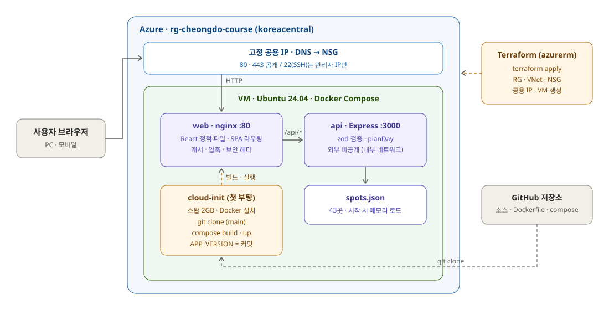

# 청도 코스 메이커

> 자가용 당일 여행자를 위한 청도 **하루 일정 플래너** — 날짜 · 시각 · 동행 · 관심사를 고르면, 그날 문을 연 곳만으로 관광 · 점심 · 카페 · 저녁 · 야간 관광을 시각과 이동 시간까지 적어 준다.

| 홈 — 조건 입력 | 결과 — 하루 타임라인 |
|---|---|
|  |  |

## 프로젝트 개요

| 항목 | 내용 |
|---|---|
| 기간 | 2026.10.30 – 2026.11.01 (3일) |
| 인원 | 1명 — AI 협업 (설계 · 리뷰: Claude / 구현: GitHub Copilot CLI) |
| 배경 | 2026 청도 바이브코딩 해커톤(GitHub Copilot + Azure 필수) 대비 프로젝트 |
| 담당 | 기획 · 설계 · 데이터 선정 · 일정 알고리즘 설계 · AI 구현 리뷰 · 배포 구성(Docker, Terraform) |
| 규모 | PR 26개 · 테스트 166개 (앱 160 + Terraform 6) · 장소 데이터 43곳 |

**풀려는 문제** — 처음 청도를 찾는 사람은 운문사 · 와인터널 · 레일바이크를 알아도 *어느 순서로, 몇 시에 가야 문이 열려 있고, 점심 · 저녁은 어디서 먹을지* 알기 어렵다. 장소마다 위치 · 체류 시간 · 요일별 운영시간 · 쉬는 시간이 달라 직접 짜려면 검색과 계산이 필요하다.

## 주요 기능

| 기능 | 설명 |
|---|---|
| 하루 일정 생성 | 방문 날짜의 요일 운영시간 · 쉬는 시간 · 입장 마감을 지키며 관광 → 점심(11:30–13:30 도착) → 카페 → 저녁(17:30–19:00 도착) → 야간 관광 배치 |
| 이동 시간 계산 | 좌표 거리 × 도로 보정 1.4 ÷ 40km/h + 주차 5분, 5분 단위 |
| 결과 설명 | 관심사 일치 태그, 개장까지 "여유 N분", 빠진 장소와 이유(이날 휴무 · 시간 부족), 식당이 없을 때 안내 |
| 공유 URL | 같은 URL은 항상 같은 일정 (결정적 계산, 서버 시간대와 무관한 요일 계산) |
| 장소 상세 | 사진과 출처, 요일별 운영시간, 카카오맵 링크, 가까운 관광지, 일정 속 앞뒤 장소 |
| 상태 화면 · 접근성 | 로딩 · 빈 결과 · 400 · 404 화면, 키보드 이동 · 포커스 표시, 390px 모바일 |

| 장소 상세 | 모바일 (390px) |
|---|---|
|  |  |

<sub>화면 속 장소 사진: ⓒ한국관광공사 (공공누리 제1유형)</sub>

## 아키텍처



- **모노레포** (npm workspaces) — `apps/web`(React) · `apps/api`(Express) · `packages/shared`(타입 · 상수 · zod 스키마를 화면과 서버가 공유)
- **web** — nginx가 React 정적 파일을 주고 `/api/*`만 api로 넘긴다. api 포트는 외부에 열지 않는다.
- **api** — `spots.json`을 시작할 때 zod로 검증해 메모리에 올리고, 순수 함수 `planDay`로 일정을 계산한다. 동작 중 외부 API 호출 없음.
- **배포** — Azure VM(Ubuntu 24.04) 한 대 + Docker Compose. 포털 · CLI 수동 절차([런북](docs/06-deploy/README.md))와 같은 구성을 Terraform으로 정의해, `terraform apply` 한 번이면 리소스 생성부터 VM 첫 부팅 때 저장소 빌드 · 실행까지 끝난다([`infra/terraform`](infra/terraform/README.md)).

## 기술 스택

| 영역 | 기술 | 선택 이유 |
|---|---|---|
| 프론트엔드 | React 19, React Router 7, Vite 8, Tailwind CSS 4 | 화면 3개짜리 SPA를 빠르게, 디자인 토큰을 클래스로 강제 |
| 백엔드 | Express 5, zod 4, pino, tsup | 읽기 전용 API 4개, 쿼리 · 데이터 검증을 스키마 하나로 |
| 공통 | TypeScript, npm workspaces | 화면과 서버가 같은 타입 · 검증 규칙 사용 |
| 데이터 | JSON 파일 (DB 없음) | 43곳 · 읽기 전용이라 DB 운영 비용이 이득보다 큼 ([ADR 0003](docs/00-overview/decisions/0003-json-instead-of-db.md)) |
| 테스트 | Vitest, Testing Library, Supertest | 단위 · 화면 · API 테스트를 한 도구로 |
| 인프라 | Docker Compose, nginx, Azure VM, Terraform (azurerm), cloud-init | VM 한 대로 운영과 같은 구성을 로컬에서 리허설, 인프라를 코드로 재현 |

## 하루 일정 계산

[`apps/api/src/domain/plan-day.ts`](apps/api/src/domain/plan-day.ts) — 입력만 쓰는 순수 함수 (`Date` · 난수 · I/O 없음)

1. 관광지 후보에 점수 매기기: 관심사 일치 × 10 + 동행 일치 5 (그날 휴무는 제외 사유로 기록)
2. 관심사가 맞는 상위 5곳을 각각 시작점으로 일정을 만들어 비교
3. 다음 장소는 **가치 = 점수 − 0.5 × (이동 + 기다림)** 이 가장 큰 곳, 단 식사 창 · 끝 시각을 지킬 수 있을 때만
4. 식사 창이 되면 가장 가까운 영업 중 식당 → 점심 뒤에는 가까운 카페
5. 관광 점수 합 → 총 이동 시간 → 시작 장소 순으로 최종 일정 선택

**검증** — 시나리오 S1~S9는 구현과 별도로 계산한 기대값을 리터럴로 고정했고, 별도 기준 구현과 무작위 쿼리 2,000개 차등 비교(전부 일치), 실제 데이터 전 조합 30,380개 전수 점검을 했다. 자세히: [하루 일정 계산](docs/03-architecture/recommendation-algorithm.md)

## 문제 해결

### 1. 끝 시각 직전에 관광을 넣느라 저녁이 빠지는 일정
- **문제** — 월요일 10:00–19:00 일정에서 16:45–17:45 와인터널 뒤 "영업 중인 식당이 없다"는 안내가 뜨고 저녁이 빠졌다.
- **원인** — 관광을 고를 때 "저녁 식당에 19:00까지 도착 가능한가"만 보고, 식사(60분)를 끝 시각 안에 마쳐야 한다는 조건을 보지 않았다.
- **해결** — 식사 도달 기한을 `min(식사 창 마감, 끝 시각 − 60분)`으로 바꾸고, 이 경우를 회귀 시나리오 S9로 고정했다.
- **결과** — 실제 데이터 30,380개 조건에서 점심 · 카페 · 저녁 누락 0.

### 2. 문 열기를 110분 기다리는 일정
- **문제** — 테스트 시나리오의 기대값을 계산해 보니, 14:00에 16:00 개장 장소를 고르고 110분을 기다리는 일정이 나왔다.
- **원인** — 장소 가치에 이동 시간만 감점하고 기다리는 시간은 반영하지 않았다.
- **해결** — 가치 = 점수 − 0.5 × (이동 + **기다림**). 구현을 맡기기 전에 별도 기준 구현으로 규칙을 먼저 돌려 본 덕에 코드가 아니라 설계 단계에서 고쳤다.
- **결과** — 60분 넘는 기다림은 08:00 출발의 첫 장소(개장 대기)에서만 남았다.

### 3. 야간 관광지가 오후에 먼저 쓰여 저녁 뒤가 비는 일정
- **원인** — 밤까지 여는 곳(프로방스 16–22시)이 오후에도 후보라 먼저 선택됐다.
- **해결** — 저녁을 넣는 날은 19시 이후까지 여는 관광지를 저녁 뒤로 미룬다.
- **결과** — 21:00까지인 일정의 89%가 저녁 뒤 야간 관광을 포함.

### 4. 관광 데이터 저작권 — "콘텐츠 캐싱 금지"
- **문제** — 한국관광공사 TourAPI 이용 정책상 수집한 콘텐츠를 서버에 저장해 서비스할 수 없다.
- **해결** — 수집을 오프라인 조사 도구([`tools/tourapi`](tools/tourapi/README.md))로 분리하고 원본은 git 밖에만 둔다. 저장소에는 대조해 확인한 사실(좌표 · 운영시간)과 직접 쓴 소개 문장, 공공누리 제1유형 사진 URL과 출처만 넣었다. 공식 페이지와 다르면 공식을 따랐다 (예: 프로방스 가을 시즌 운영시간).

### 5. 1GiB VM 빌드와 Docker 빌드 컨텍스트
- **문제** — B1s(메모리 1GiB) VM에서 npm 설치 · Vite 빌드가 메모리 부족으로 멈출 수 있고, 로컬 Terraform 프로바이더 캐시(239MB)가 Docker 빌드 컨텍스트에 섞여 들어갔다.
- **해결** — cloud-init에서 스왑 2GB를 먼저 만들고, `.dockerignore`에 `infra/terraform`을 추가했다.
- **결과** — 빌드 컨텍스트 239MB → 수 KB.

## AI 협업 개발

```
Claude: 설계 문서 · 작업 단위 프롬프트(목표 · 참조 문서 · 파일 · 규칙 · 테스트 기대값 · 완료 기준)
  └▶ GitHub Copilot CLI: 테스트 먼저 작성 → 구현 → 검사 실행 → 보고
        └▶ Claude: 검사 재실행 · 반례 탐침 · 브라우저 확인 · 기준 구현 차등 비교
              └▶ 수정 프롬프트 → PR → 머지
```

- 프롬프트 16개, 그중 수정 라운드가 필요했던 것과 이유를 [리뷰 기록](docs/05-copilot/review-log.md)에 남겼다.
- 알고리즘 프롬프트는 기대값을 사람이 따로 계산해 고정하고, 실제 데이터로 기준 구현과 차등 비교해 "테스트는 통과하지만 규칙이 틀린" 경우를 걸렀다.

## 실행

Node 22 이상.

```bash
npm install
npm run dev          # 웹 http://localhost:5173 · API http://localhost:3000
npm test             # shared 60 · api 52 · web 48
npm run docker:up    # 운영과 같은 컨테이너 구성 http://localhost:8080
```

배포 구성 검사 (Azure 계정 없이):

```bash
cd infra/terraform
terraform init -backend=false && terraform validate && terraform test
```

## 폴더 구조

```
├── apps/
│   ├── web/          React 화면 (홈 · 결과 타임라인 · 장소 상세)
│   └── api/          Express API · 일정 계산(src/domain) · 장소 데이터(data/spots.json)
├── packages/shared/  타입 · 상수 · zod 스키마 · 시각 도우미
├── infra/            nginx · compose(로컬 · 운영) · 서버 설정 스크립트 · terraform/
├── tools/tourapi/    TourAPI 수집 · 후보표 도구 (결과는 git 밖)
└── docs/             기획 · 설계 · 아키텍처 · 결정 기록 · AI 프롬프트와 리뷰 기록 · 배포 런북
```

문서 전체: [`docs/README.md`](docs/README.md)
