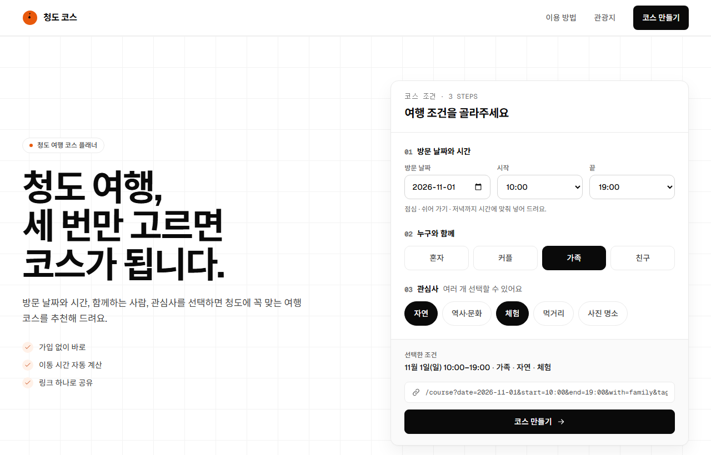
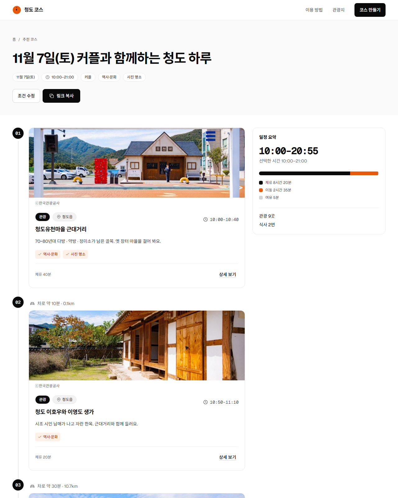
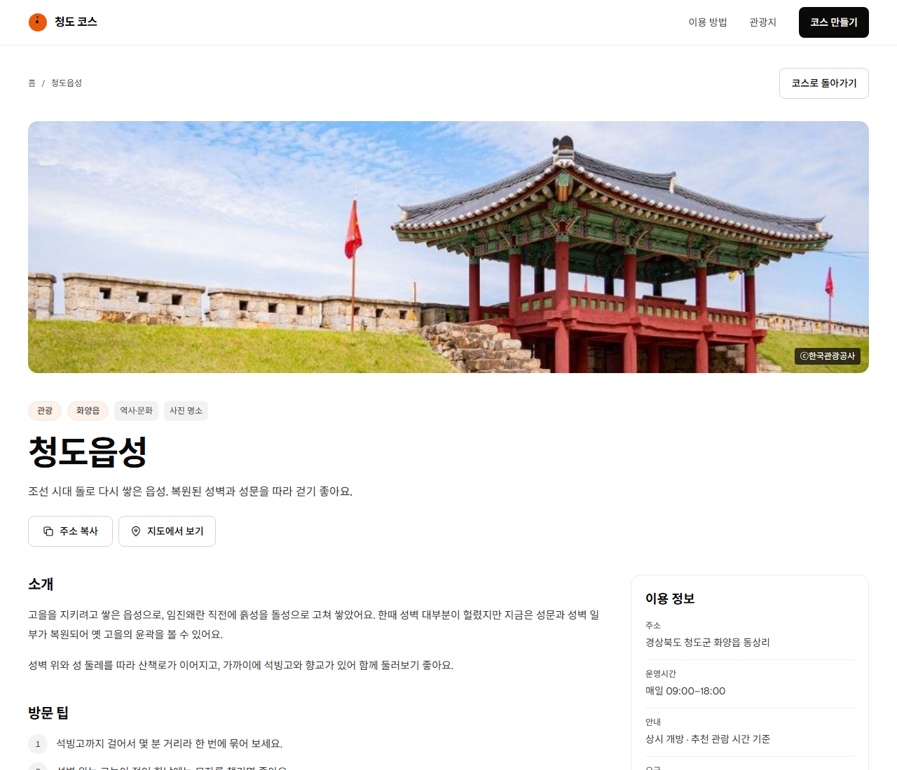
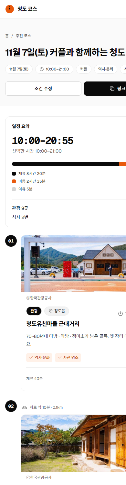

# 청도 코스 메이커

자가용으로 청도에 당일치기로 오는 사람을 위한 **하루 일정 플래너**. 방문 날짜 · 시작 · 끝 시각, 동행, 관심사를 고르면 그날 문을 연 곳만으로 관광 → 점심 → 카페에서 쉬어 가기 → 저녁 → 야간 관광을 도착 · 출발 시각과 차 이동 시간까지 적어 보여준다.

> 2026 청도 바이브코딩 해커톤(GitHub Copilot + Azure) 대비 프로젝트 · 기획 · 설계는 Claude, 구현은 GitHub Copilot CLI, 리뷰 · 통합은 Claude가 맡은 AI 협업 개발

| 홈 — 조건 입력 | 결과 — 하루 타임라인 |
|---|---|
|  |  |
| **장소 상세** | **모바일 (390px)** |
|  |  |

<sub>화면 속 장소 사진: ⓒ한국관광공사 (공공누리 제1유형)</sub>

## 주요 기능

- **하루 일정 계산** — 요일별 운영시간 · 쉬는 시간 · 입장 마감을 지키며, 점심(도착 11:30–13:30) · 쉬어 가기 · 저녁(17:30–19:00) · 야간 관광을 시각과 함께 배치
- **이동 시간** — 좌표 사이 거리로 계산 (직선거리 × 도로 보정 1.4 ÷ 40km/h + 주차 5분, 5분 단위)
- **설명 가능한 결과** — 관심사 일치 태그, 여는 시간까지 "여유 N분", 빠진 장소와 이유(이날 휴무 · 시간 부족), 식당이 없을 때 안내
- **공유 URL** — `/course?date=2026-11-07&start=10:00&end=21:00&with=couple&tags=history,photo` 를 다시 열면 같은 일정 (결정적 계산)
- **장소 상세** — 사진과 출처, 요일별 운영시간, 카카오맵 링크, 가까운 관광지, 하루 일정 속 앞뒤 장소

## 하루 일정 계산

순수 함수 `planDay`([`apps/api/src/domain/plan-day.ts`](apps/api/src/domain/plan-day.ts))가 조건에 맞는 관광지 후보를 점수(관심사 일치 × 10 + 동행 일치 5)로 고른 뒤, 시작 장소 후보 5곳마다 탐욕적으로 일정을 만들고 가장 좋은 것을 고른다.

- 다음 장소의 가치 = 점수 − 0.5 × (이동 + 기다림) — 문 열 때까지 오래 기다리는 선택을 피함
- 저녁을 넣는 날은 밤까지 여는 곳(프로방스 · 온천)을 저녁 뒤로 미뤄 야간 관광으로 사용
- 식사는 창 안에 도착하고 끝 시각 전에 마쳐야 하며, 같은 식당은 하루 한 번

**검증**

- 시나리오 테스트 S1~S9 — 기대값을 구현과 별도로 계산해 리터럴로 고정
- 기준 구현과 차등 비교 — 무작위 쿼리 2,000개에서 응답 JSON 전부 일치
- 실제 데이터 전수 점검 — 7일 × 시작 7 × 끝 5 × 동행 4 × 관심사 31 = 30,380 조건에서 점심 · 쉬어 가기 · 저녁 누락 0, 21시까지 일정의 89%가 저녁 뒤 야간 관광 포함

자세히: [하루 일정 계산](docs/03-architecture/recommendation-algorithm.md) · [ADR 0005](docs/00-overview/decisions/0005-day-plan-coordinates-hours.md)

## 데이터

청도군 **43곳** (관광 27 · 식당 8 · 카페 8). [`apps/api/data/spots.json`](apps/api/data/spots.json)

- 한국관광공사 **TourAPI**로 청도군 전체 133건을 수집하는 도구([`tools/tourapi`](tools/tourapi/README.md))를 만들고, 후보표에서 권역 · 관심사 · 식사 동선을 고려해 선정
- 콘텐츠 캐싱 금지 정책에 따라 수집 원본은 저장소 · 서비스에 넣지 않고, **확인한 사실과 직접 쓴 소개 문장**만 저장
- 운영시간은 요일별 구조로 입력하고 공식 자료와 대조 (예: 청도 프로방스는 공식 홈페이지 가을 시즌표), 사진은 공공누리 제1유형만 출처와 함께
- 서비스는 동작 중 외부 API를 부르지 않는다 — JSON을 시작 시 zod로 검증해 메모리에 올림

선정 기록: [`docs/01-product/spots-data.md`](docs/01-product/spots-data.md)

## 아키텍처

```
브라우저 ──▶ web 컨테이너 (nginx)
              ├─ React 정적 파일 (SPA 새로고침 대응, 해시 자산 1년 캐시, 보안 헤더)
              └─ /api/* ──▶ api 컨테이너 (Express · :3000, 외부 비공개)
                              └─ spots.json → zod 검증 → 메모리 → planDay
```

- 모노레포(npm workspaces): `apps/web` · `apps/api` · `packages/shared`(타입 · 상수 · zod 스키마를 화면과 서버가 공유)
- 로컬 리허설(`infra/compose.local.yml`, :8080)과 운영(`infra/compose.yml`, :80)이 같은 Dockerfile · nginx 설정을 사용

자세히: [시스템 구조](docs/03-architecture/system-overview.md) · [API](docs/03-architecture/api-spec.md) · [데이터 모델](docs/03-architecture/data-model.md)

## 배포 (Azure)

Azure VM(Ubuntu 24.04) 한 대에 Docker Compose로 web · api 컨테이너를 올리는 구성이다.

- **수동 절차** — 포털 · CLI로 리소스 그룹 → VM · NSG(80 · 443 공개, 22는 내 IP만) → 서버 설정(Docker · 스왑) → 저장소를 받아 VM에서 빌드 · 실행. [배포 런북](docs/06-deploy/README.md)
- **Terraform** — 같은 구성을 코드로 정의했다. Azure 무료 체험(30일) 크레딧이 끝난 뒤에도 새 구독에서 `terraform apply` 한 번으로 다시 올릴 수 있게, VM 첫 부팅 때 cloud-init이 저장소를 받아 빌드까지 한다. [`infra/terraform`](infra/terraform/README.md)

```powershell
cd infra/terraform
terraform init
terraform apply     # 리소스 그룹 · VNet · NSG · 고정 IP + DNS · VM → 첫 부팅 때 앱 빌드 · 실행
terraform destroy   # 정리
```

Terraform 코드는 Azure 계정 없이 `terraform validate` · `terraform test`(mock provider로 plan 검사 6개)와 `cloud-init schema` 검사로 확인한다.

## 기술 스택

| 영역 | 기술 |
|---|---|
| 프론트엔드 | React 19, React Router 7, Vite 8, Tailwind CSS 4, TypeScript |
| 백엔드 | Express 5, zod 4, pino, tsup |
| 테스트 · 품질 | Vitest, Testing Library, Supertest, ESLint, Prettier |
| 인프라 | Docker Compose, nginx, Azure VM (Ubuntu 24.04), Terraform (azurerm), cloud-init |
| 데이터 | TourAPI (한국관광공사) — 오프라인 조사 도구로만 사용 |

선택 이유: [ADR 0001](docs/00-overview/decisions/0001-tech-stack.md) · [ADR 0003 (DB 대신 JSON)](docs/00-overview/decisions/0003-json-instead-of-db.md)

## AI 협업 개발

1. **Claude** — 기획 · 설계 문서, 작업 단위 프롬프트 16개 작성 ([`docs/05-copilot`](docs/05-copilot/README.md))
2. **GitHub Copilot CLI** — 프롬프트대로 테스트를 먼저 쓰고 구현
3. **Claude** — 검사 재실행, 반례 탐침, 브라우저 확인, 기준 구현과 차등 비교 → 수정 프롬프트 → PR 머지

리뷰에서 잡은 문제와 수정 과정은 [리뷰 기록](docs/05-copilot/review-log.md)에 프롬프트마다 남겼다 (예: 끝 시각 직전 관광을 넣느라 저녁이 빠지던 일정 계산 버그).

## 실행

Node 22 이상.

```bash
npm install
npm run dev          # 웹 http://localhost:5173 · API http://localhost:3000
npm test             # shared 60 · api 52 · web 48
npm run docker:up    # 운영과 같은 컨테이너 구성 리허설 http://localhost:8080
```

## 구조

```
├── apps/
│   ├── web/          React 화면 (홈 · 결과 타임라인 · 장소 상세)
│   └── api/          Express API, 일정 계산(domain/), 장소 데이터(data/spots.json)
├── packages/shared/  타입 · 상수 · zod 스키마 · 시각 도우미
├── infra/            nginx, compose(로컬 · 운영), 서버 설정 스크립트, terraform/
├── tools/tourapi/    TourAPI 수집 · 후보표 도구 (결과는 git 밖)
└── docs/             기획 · 설계 · 아키텍처 · Copilot 프롬프트와 리뷰 기록 · 배포 런북
```

문서 전체 지도: [`docs/README.md`](docs/README.md)
