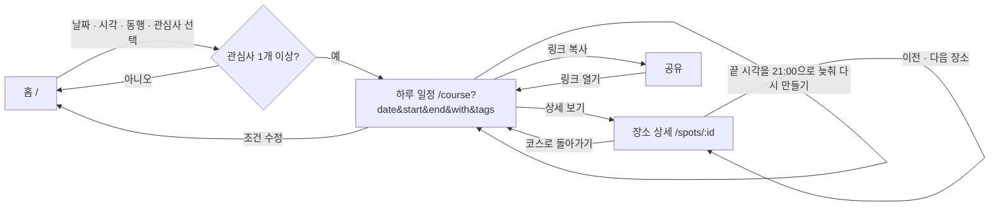

# 사용자 흐름

## 핵심 흐름

## 단계별 설명

| 단계 | 화면 | 사용자 행동 | 시스템 반응 |
|---|---|---|---|
| 1 | 홈 | 방문 날짜 · 시작 · 끝 시각 · 동행 · 관심사 선택 | 선택 요약과 공유 URL 미리보기 즉시 갱신. 시작을 바꿔 끝이 범위(시작 + 3시간~21:00) 밖이 되면 끝을 시작 + 3시간으로 맞춤. 관심사가 없으면 버튼 비활성 + 안내 문구 |
| 2 | 홈 | "코스 만들기" | `/course?date=2026-11-07&start=10:00&end=19:00&with=family&tags=nature,experience`로 이동 |
| 3 | 하루 일정 | (자동) | 스켈레톤 표시 → `GET /api/course` 호출 → 요약 · 타임라인 · 빠진 장소 렌더링 |
| 4 | 하루 일정 | "상세 보기" | `/spots/:id`로 이동. 일정 쿼리는 `from`으로 넘겨 돌아갈 수 있게 하고, 상세에 "이 코스에서" 이전 · 다음 장소를 보여 줌 |
| 5 | 하루 일정 | "링크 복사" | 현재 URL을 클립보드에 복사, 버튼이 2초간 "복사됨"으로 바뀜. 복사할 수 없으면 URL 입력칸을 보여 줌 |
| 6 | 하루 일정 | "조건 수정" | 홈으로 이동하며 현재 조건을 폼에 미리 채움 |

## 예외 흐름

| 상황 | 화면 | 처리 |
|---|---|---|
| 일정에 넣을 관광지가 없음 | 하루 일정 → 빈 결과 상태 | "끝 시각 늦추기"(끝 21:00 전일 때), "관심사 더 고르기" 버튼 |
| 그 시간에 연 식당 · 카페가 없음 | 하루 일정 | 그 블록 없이 일정을 만들고 안내 문장(`notices`)을 보여 줌 |
| 잘못된 쿼리 (`date=2026-02-30`, `start=07:30`, 알 수 없는 태그) | 하루 일정 → 400 상태 | 문제가 된 값을 강조하고 "조건 다시 고르기" |
| 없는 장소 id | 장소 상세 → 404 상태 | "장소 목록으로", "홈으로" |
| 네트워크 · 서버 오류 | 공통 오류 상태 | "다시 시도" 버튼 |
| 존재하지 않는 경로 | 404 페이지 | 홈으로 |

## URL 설계

| 경로 | 쿼리 | 예 |
|---|---|---|
| `/` | `date`, `start`, `end`, `with`, `tags` (선택, 폼 미리 채움) | `/?date=2026-11-07&start=10:00&end=19:00&with=family&tags=nature` |
| `/course` | `date`, `start`, `end`, `with`, `tags`, `exclude`(P1) | `/course?date=2026-11-07&start=10:00&end=19:00&with=family&tags=nature,experience` |
| `/spots/:id` | `from` (돌아갈 일정 쿼리, URL 인코딩) | `/spots/eupseong?from=date%3D2026-11-07%26start%3D10%3A00...` |

- 쿼리 순서는 `date → start → end → with → tags`로 고정하고, `exclude`가 있으면 끝에 붙인다.
- `tags`는 쉼표로 구분하고, **태그 정의 순서로 정렬해서** URL을 만든다 → 같은 조건은 항상 같은 URL.
- 홈은 과거 날짜를 고르지 못하게 한다 (미리 채울 때 과거 날짜는 오늘로 바꿈). API는 과거 날짜도 받는다 (같은 URL이 날짜가 지나도 400이 되지 않게).
